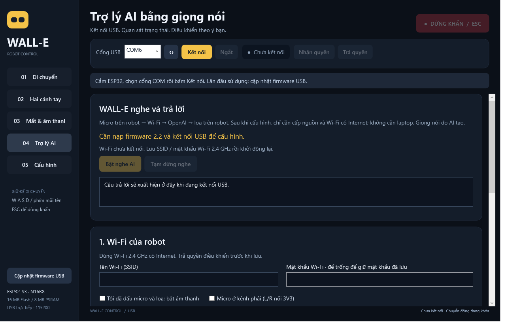

# Trợ lý AI giọng nói độc lập — firmware 2.2.0

ESP32-S3 thu INMP441, tự nối Wi-Fi có Internet và gọi **OpenAI Realtime API** qua TLS/WebSocket; câu trả lời phát qua MAX98357A và loa. Laptop chỉ dùng để nạp và cấu hình lần đầu. Đây là kết nối OpenAI API, không chạy ứng dụng Codex/ChatGPT trên vi điều khiển. API dùng tài khoản/hạn mức thanh toán riêng của người dùng.

**Board hiện tại đã được nạp 2.2.0 qua COM6 ngày 2026-10-21 và xác nhận khởi động/giao thức GUI.** GUI đã mở trang Trợ lý AI. Chưa cấu hình Wi-Fi, audio hay API key; sau khi tạo key mới, tiếp tục từ bước 3 bên dưới.

## Thiết lập trên máy hiện tại

1. **Thu hồi API key đã gửi vào cuộc trò chuyện và tạo key mới** ở [OpenAI API keys](https://platform.openai.com/api-keys). Không gửi key mới vào chat.
2. Cắm ESP32 qua USB, mở `E:\Robot_Mini\WALL-E-Control.exe`, chọn cổng COM thực tế và **Cập nhật firmware USB**. Sau khi nạp, thả BOOT và bấm RESET/EN. Bấm **Kết nối** để cấu hình. Board đang chạy 2.0/2.1 phải nạp 2.2 trước.
3. Mở **Trợ lý AI**, **Trả quyền** nếu đang giữ quyền điều khiển. Trong phần Wi-Fi, nhập SSID/mật khẩu mạng **2.4 GHz có Internet**. Wi-Fi AP `WALLE-…` của robot chỉ dùng cấu hình/điều khiển, tự nó không cung cấp Internet.
4. Sau khi đã kiểm tra dây/nguồn, chọn **Tôi đã đấu micro và loa; bật âm thanh**. INMP441 L/R nối GND dùng kênh trái mặc định; nếu L/R nối 3V3, chọn kênh phải. Bấm **Lưu Wi-Fi & âm thanh**. Ô mật khẩu trống giữ mật khẩu đã lưu; khi đổi mạng cần nhập lại mật khẩu đúng.
5. Nhập **API key mới** trực tiếp vào ô mật khẩu của GUI. Model mặc định `gpt-realtime-2.1-mini`, giọng `marin`. Tài khoản phải có quyền dùng model; có thể đổi sang model Realtime khác mà tài khoản được cấp quyền.
6. Chọn **Tự nghe AI sau khi bật nguồn**, bấm **Lưu cấu hình AI**, rồi **Khởi động lại để áp dụng**. Chờ ESP32 nối Wi-Fi, đồng bộ giờ và kết nối OpenAI. Kết nối USB lại để xem trạng thái, giữ chế độ chỉ xem trạng thái, không nhận quyền điều khiển.
7. Khi hiện **Đang nghe — bạn có thể nói**, nói rõ một câu rồi im lặng khoảng 0,8 giây. Robot gửi câu hỏi, chờ AI trả lời và phát ra loa. Có thể rút USB laptop và cấp nguồn phù hợp cho robot; Wi-Fi có Internet vẫn cần hoạt động.

## Dây âm thanh theo firmware hiện tại

| Thiết bị | Tín hiệu | ESP32-S3 |
|---|---|---|
| INMP441 | SCK/BCLK | GPIO17 |
| INMP441 | WS/LRCLK | GPIO18 |
| INMP441 | SD | GPIO21 |
| INMP441 | VDD / GND | 3V3 / GND |
| INMP441 | L/R | GND = trái; 3V3 = phải |
| MAX98357A | BCLK / LRC | GPIO17 / GPIO18 |
| MAX98357A | DIN | GPIO39 |
| MAX98357A | VIN / GND | Nguồn 5 V phù hợp / GND chung |
| Loa | Hai dây | SPK+ và SPK− của MAX98357A |

Xem [wiring.md](wiring.md) về nguồn, module và dây loa. Bật audio chỉ sau khi ngoại vi đã đấu đúng. Điều chỉnh âm lượng ở trang **Mắt & âm thanh**, sau đó lưu cấu hình phần cứng để giữ qua lần bật nguồn sau. Motor/servo vẫn cần các xác nhận phần cứng riêng.

## Cách hoạt động

- Audio I2S giữ **PCM16 mono 16 kHz**. Firmware chuyển sang **24 kHz** khi gửi OpenAI, rồi chuyển câu trả lời về 16 kHz để phát. Không cần thư viện Arduino hay cài dịch vụ trên laptop.
- VAD đo năng lượng ngay trên ESP32: cần khoảng 120 ms có tiếng nói, giữ 200 ms âm thanh trước đó, kết thúc sau 800 ms im lặng; mỗi câu tối đa 12 giây. Ngưỡng mặc định 250 RMS, chỉnh 50–5000 trong GUI. Đây là phát hiện tiếng nói theo mức âm, **chưa có từ đánh thức**.
- Robot chỉ gửi âm thanh sau khi phát hiện một lượt nói. Không thu micro lúc chờ/phát câu trả lời; chờ thêm khoảng 0,7 giây sau phát để giảm tiếng vọng. Chưa có khử vọng chuyên dụng hay ngắt lời khi robot đang nói.
- Câu trả lời được nhận vào bộ đệm PSRAM, tối đa 45 giây, rồi mới phát. Bản này ưu tiên luồng hỏi–đáp từng lượt; chưa phát theo từng gói ngay khi AI sinh âm thanh. Câu trả lời có giọng nói do AI tạo.
- Session Realtime giữ ngữ cảnh khi kết nối còn sống; mất mạng, lỗi hoặc nhận quyền điều khiển sẽ đóng session và bắt đầu hội thoại mới khi nối lại. Model được yêu cầu trả lời ngắn bằng tiếng Việt, không có công cụ điều khiển motor/servo hoặc tra cứu Internet.
- Tối đa 30 lượt yêu cầu trong mỗi cửa sổ một giờ tính từ lúc bật; giới hạn nhằm giảm các lượt do tiếng ồn. Mỗi response giới hạn 1024 output tokens. Đây không phải hạn mức chi phí trên tài khoản OpenAI; đặt hạn mức sử dụng phù hợp trong tài khoản API.
- AI tự tạm dừng khi controller USB/Web nhận quyền; trả quyền để tiếp tục. **Tạm dừng nghe** / **Bật nghe AI** trong GUI chỉ đổi trạng thái hiện tại, không thay thiết lập tự nghe sau bật nguồn. Dừng khẩn, lỗi nguồn, ngủ và các trạng thái safety chặn âm thanh AI. Lưu cấu hình đưa robot vào bảo trì và cần khởi động lại.

## Key và kết nối

Key được nhập qua **USB vật lý**, lưu vào bản ghi NVS `walle/voice_v1`, không đưa vào source, `platformio.ini`, firmware image hoặc log GUI. Telemetry/cấu hình trả về chỉ có `key_configured`; không có API key. Không cấp API cấu hình key qua HTTP LAN. Đánh dấu **Xóa API key đã lưu** đồng thời bỏ tự nghe AI để xóa key; factory reset cũng xóa bản ghi này.

NVS của dự án hiện **chưa mã hóa** và chưa bật flash encryption/secure boot. Người có quyền truy cập vật lý có thể trích xuất key từ flash. Dùng key riêng cho robot, giới hạn quyền/hạn mức tài khoản và thu hồi khi mất thiết bị. Bản firmware này không hứa bảo vệ key khỏi truy cập vật lý.

Kết nối đến `api.openai.com:443` dùng CA certificate bundle và kiểm tra hostname. Robot đồng bộ giờ bằng SNTP `pool.ntp.org`; không tắt kiểm tra chứng chỉ để khắc phục lỗi giờ. Tag log `transport_ws` bị tắt vì thư viện ESP-IDF có đường lỗi ghi cả HTTP upgrade request chứa Authorization. Không bật lại tag này khi có key thật.

## Đọc trạng thái

| Trạng thái / lỗi | Xử lý |
|---|---|
| `WAIT_WIFI` | Kiểm tra SSID, mật khẩu, băng tần 2.4 GHz, router và Internet |
| `WAIT_TIME` | Cho phép DNS/NTP; kiểm tra mạng có chặn UDP123 không |
| `AUDIO_NOT_READY` | Bật audio, khởi động lại; kiểm tra I2S, nguồn micro/amp và chẩn đoán module |
| `LISTENING` / `RECORDING` | Sẵn sàng nghe / đang thu câu hỏi |
| `THINKING` / `SPEAKING` | Đang gửi/chờ AI / đang phát câu trả lời |
| `PAUSED` | Trả controller hoặc bấm Bật nghe AI; thoát ngủ/dừng khẩn theo quy trình riêng |
| `API_AUTH` | Key sai/đã thu hồi: nhập key mới, lưu và khởi động lại |
| `API_QUOTA` | Kiểm tra hạn mức/thanh toán; khởi động lại sau khi xử lý |
| `API_MODEL_ACCESS` | Kiểm tra quyền model, sửa model rồi lưu/khởi động lại |
| `API_ERROR` | OpenAI từ chối cấu hình/yêu cầu; kiểm tra model và thiết lập, khởi động lại để thử lại |
| `TLS_OR_NETWORK` / `NETWORK_OR_AUDIO` | Kiểm tra Internet/DNS/giờ/nguồn; lỗi tạm thời thử lại sau 60 giây |
| `MIC_OVERRUN` | Thu bị mất mẫu; kiểm tra nguồn/âm thanh và tải, thử lại sau 60 giây |
| `AUDIO_REPLY_LIMIT` | Câu trả lời quá dài hoặc PCM lỗi; hỏi ngắn hơn |
| `RATE_LIMITED` | Đợi cửa sổ một giờ mới; tăng ngưỡng mic nếu tiếng ồn gây nhiều lượt |

## Kiểm thử và giới hạn kiểm chứng

Đã có kiểm thử C dùng mã production cho VAD, chuyển đổi mẫu 16/24 kHz, tính liên tục giữa các block, ghép WebSocket FIN/continuation, giới hạn bộ đệm, kiểm tra cấu hình và lọc key. Kiểm thử WPF dùng nút và ô nhập thật để kiểm tra lưu qua USB, xóa ô mật khẩu, cấm lưu AI khi giữ quyền và tương thích firmware cũ.

**Chưa gọi API thật hoặc thử micro/loa trên board trong lần triển khai này.** Không dùng key đã lộ trong cuộc trò chuyện để kiểm thử. Đã nạp 2.2 và xác nhận trạng thái `IDLE`, `armed=false`, `servo_enabled=false`, `ai.state=DISABLED`, `key_configured=false`. Các kiểm thử trên máy và xác nhận boot không xác nhận Wi-Fi Internet, chất lượng mic, mức âm, TLS trên chip hoặc phản hồi loa thực tế.

Tài liệu API đối chiếu: [Realtime qua WebSocket](https://developers.openai.com/api/docs/guides/realtime-websocket), [Realtime conversations](https://developers.openai.com/api/docs/guides/realtime-conversations), [GPT-Realtime-2.1 Mini](https://developers.openai.com/api/docs/models/gpt-realtime-2.1-mini).
