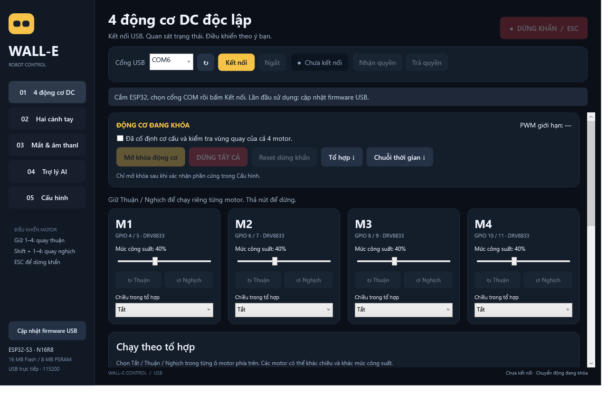
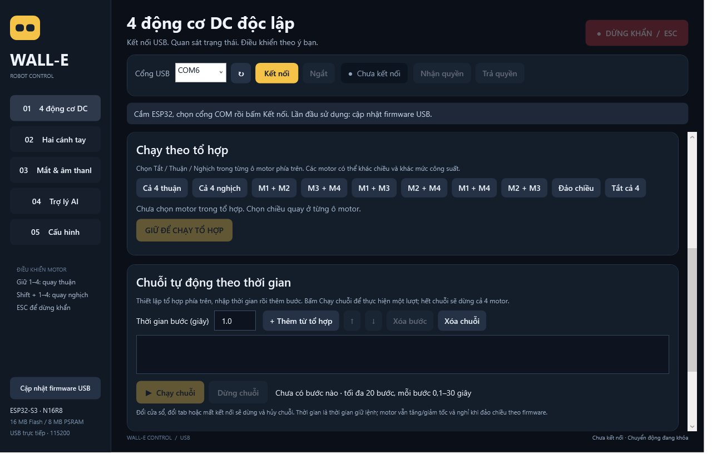

# GUI điều khiển WALL-E trên Windows

Ứng dụng: **`E:\Robot_Mini\WALL-E-Control.exe`**. Giao diện tiếng Việt, chạy bằng WPF/.NET Framework có sẵn trên laptop hiện tại; không cần Python GUI, trình duyệt hoặc đổi mạng Wi-Fi.



## Sử dụng lần đầu

1. Mở `WALL-E-Control.exe` trong thư mục dự án.
2. Cắm ESP32 bằng USB, chọn **COM6** hoặc bấm nút quét nếu Windows gán cổng khác. Đóng Serial Monitor để nhường cổng cho GUI.
3. **Bấm “Cập nhật firmware USB” để nạp firmware 2.2.0 hỗ trợ GUI và AI giọng nói.** Firmware 2.0.0 đã nạp trước đây chưa có giao thức điều khiển USB này. Tác vụ nạp dùng PlatformIO của tài khoản Windows hiện tại và hiển thị log trong GUI; giữ thư mục dự án cùng ứng dụng.
4. Nếu công cụ không kết nối được: giữ BOOT, bấm rồi thả RESET/EN, sau đó thả BOOT. Kiểm tra lại cổng sau thao tác này rồi nạp lại. Sau khi nạp thành công, thả BOOT và bấm RESET/EN một lần.
5. Bấm **Kết nối**. GUI bắt tay qua USB, đọc trạng thái và cấu hình; không tự nhận quyền hay mở khóa motor/servo.

Không cần nhập token khi dùng USB vật lý. Giao diện Web cũ và xác thực Wi-Fi vẫn được giữ nguyên. Hai giao diện dùng **chung một controller lease**, nên không cùng điều khiển chuyển động.

## Bốn động cơ DC độc lập

- **Nhận quyền** để giữ quyền điều khiển.
- Nếu phần cứng chưa được xác nhận: vào **Cấu hình**, chỉ đánh dấu xác nhận khi đã kiểm tra GPIO, nguồn, nSLEEP và cơ khí. **Trả quyền**, lưu rồi khởi động lại để áp dụng. Không bật LCD/audio/đo pin khi ngoại vi chưa đấu đúng.
- Tab **01 — 4 động cơ DC** hiển thị M1–M4 riêng, không ghép theo bánh xích. Xác nhận cơ cấu đã cố định và vùng quay an toàn, rồi bấm **Mở khóa động cơ**.
- Mỗi kênh có mức công suất riêng và hai nút **Thuận / Nghịch**: giữ để chạy riêng motor đó, thả để gửi 0 cho cả bốn kênh. Có thể giữ các phím **1–4** đồng thời; **Shift + 1–4** chọn chiều nghịch tại thời điểm nhấn phím. Thả từng phím chỉ dừng kênh tương ứng. Mức công suất không phải tốc độ đo.
- Trong **Chạy theo tổ hợp**, chọn Tắt/Thuận/Nghịch ở mỗi ô motor rồi giữ **GIỮ ĐỂ CHẠY TỔ HỢP**. Có nút chọn nhanh cả bốn hoặc các cặp M1+M2, M3+M4, M1+M3, M2+M4, M1+M4, M2+M3; có thể đổi chiều/mức từng kênh sau khi chọn. Chọn preset hoặc kéo thanh trượt không tự khởi chạy motor.
- **DỪNG TẤT CẢ** khóa motor và servo. **ESC / Dừng khẩn** gửi lệnh E-STOP có chốt; cần xác nhận an toàn rồi reset riêng trước khi mở khóa lại.
- Đổi cửa sổ sẽ dừng và trả quyền. Đổi tab sẽ khóa chuyển động. Kết nối lại không tự nhận quyền, mở khóa hay phát lại phím đang giữ.

| Kênh mới | Kênh firmware cũ | GPIO IN1 / IN2 |
|---|---|---|
| M1 | LF | 4 / 5 |
| M2 | LR | 6 / 7 |
| M3 | RF | 8 / 9 |
| M4 | RR | 10 / 11 |

Mức từng motor được nhân với giới hạn PWM đang chạy trên firmware. Ví dụ mức 40% và giới hạn 25% tương ứng lệnh 10% trước trim/ramp. Giới hạn nguồn, cơ cấu và xác nhận phần cứng vẫn áp dụng. Bản cập nhật GUI này dùng lệnh `motors` đã có trong firmware 2.2; board hiện tại không cần nạp lại.

## Chuỗi motor theo thời gian

Bấm **Chuỗi thời gian ↓** ở đầu tab để đến trình soạn chuỗi. Hoặc cuộn xuống dưới phần tổ hợp.

1. Chọn chiều và mức M1–M4 cho bước đầu, nhập **Thời gian bước (giây)** rồi bấm **+ Thêm từ tổ hợp**.
2. Đổi tổ hợp/mức/thời gian và thêm các bước tiếp theo. Mỗi bước chụp lại các giá trị tại lúc thêm, nên chỉnh tổ hợp sau đó không sửa các bước đã thêm.
3. Chọn một dòng để đưa lên/xuống hoặc xóa. Tối đa 20 bước, mỗi bước 0,1–30 giây. Một bước Tắt cả 4 tạo khoảng dừng có thời gian.
4. Sau khi nhận quyền, xác nhận và mở khóa motor, bấm **Chạy chuỗi**. GUI chạy một lượt và gửi dừng cả bốn motor khi kết thúc. **Dừng chuỗi** hủy chuỗi và gửi 0; **DỪNG TẤT CẢ** còn khóa chuyển động.

Ví dụ: chọn **M1 + M2**, nhập `2`, thêm bước; chọn **M3 + M4**, nhập `1`, thêm bước; bấm **Chạy chuỗi**. Motor vẫn tăng/giảm tốc và nghỉ khi đảo chiều theo firmware; thời gian nhập là thời gian giữ lệnh, không cam kết tốc độ cơ học ổn định hoặc độ chính xác thời gian thực.

**Chuỗi chạy trên laptop:** giữ GUI mở và USB kết nối suốt lượt chạy. Đổi tab/cửa sổ, mất phản hồi, UI gián đoạn hoặc dừng khẩn đều hủy chuỗi; không tự tiếp tục khi kết nối lại. Bản này chưa lưu chuỗi vào flash ESP32 hoặc lưu thành tệp; đóng ứng dụng sẽ xóa danh sách đang soạn. Chế độ AI độc lập qua Wi-Fi vẫn là tính năng riêng.



## Tay, mắt và âm thanh

- **Hai cánh tay:** nhận quyền, xác nhận tay không vướng và bấm Bật hai servo. Giới hạn góc được lấy từ cấu hình đang chạy trên firmware; thanh trượt và nút lên/xuống không vượt giới hạn đó.
- **Mắt & âm thanh:** 12 biểu cảm xem trước trên máy tính, hướng nhìn và độ sáng màu mắt. Chỉ gửi lệnh LCD khi LCD được bật và đang có quyền điều khiển.
- Thử loa, điều chỉnh âm lượng, bật/dừng thu micro và xem peak thực từ telemetry khi audio đã bật. GUI USB chưa tải/phát tệp WAV hoặc lưu bản thu; các chức năng đó vẫn có trong giao diện Web.
- Góc và PWM hiển thị là giá trị ra lệnh, không phải phản hồi cảm biến. Pin chỉ hiện điện áp khi có mạch đo và firmware cung cấp số đo.

## Cơ chế kết nối

Trang **Trợ lý AI** thiết lập Wi-Fi và OpenAI API key bằng các ô mật khẩu. Sau khi lưu và khởi động lại, robot hỏi–đáp bằng micro/loa qua Wi-Fi, không dùng laptop làm cầu nối. AI tạm dừng khi có controller nhận quyền; trả quyền để tiếp tục. Xem [ai_voice.md](ai_voice.md). GUI chỉ nhận cờ đã có key, không đọc lại được key; ô mật khẩu được xóa sau khi gửi lệnh lưu.

GUI gửi lệnh mỗi 100 ms khi motor được mở khóa, heartbeat mỗi 200 ms, đọc telemetry mỗi 500 ms. Không có bộ phát heartbeat nền độc lập với giao diện: nếu vòng lặp UI dừng, các lệnh cũng dừng. Khoảng ngắt UI trên 300 ms khi giữ quyền làm client ngắt và khóa phiên; ACK cũ không được dùng để tiếp tục hướng di chuyển đã giữ.

Firmware vẫn có drive timeout mặc định 400 ms, controller timeout 1 s, E-STOP có chốt và xác nhận phần cứng. USB và WebSocket được xử lý trên cùng task HTTPD để không tranh chấp controller/configuration state. Hàng đợi USB tối đa 8 lệnh đang chờ, JSON tối đa 1024 byte, không chấp nhận khung tràn/NUL rồi thực thi phần đuôi.

## Build và kiểm thử

Build GUI từ source:

```powershell
powershell.exe -NoProfile -ExecutionPolicy Bypass -File .\desktop\build.ps1
```

Build và chạy kiểm thử GUI:

```powershell
powershell.exe -NoProfile -ExecutionPolicy Bypass -File .\desktop\build.ps1 -Test
```

Cần Windows .NET Framework 4.x có WPF và trình biên dịch C# đi kèm, đã kiểm tra trên laptop hiện tại. Source nằm trong `desktop/Window.xaml`, `desktop/WallEControl.cs`, `desktop/RobotConnection.cs`. Tham khảo chính thức: [WPF](https://learn.microsoft.com/en-us/dotnet/desktop/wpf/overview/), [SerialPort.DataReceived](https://learn.microsoft.com/en-us/dotnet/api/system.io.ports.serialport.datareceived?view=netframework-4.8.1).

Kiểm thử desktop dùng các lớp client thật và adapter cổng có kịch bản: xác nhận kết nối, lease/arm, giữ/thả, ngắt phản hồi, lỗi ghi, kết nối lại, giới hạn servo, cấu hình và các sự kiện nút/tab XAML thật. Log: `.pio/gui-tests/results.txt`. Chúng không kiểm chứng chuyển động vật lý.

**Bản firmware USB mới chưa được nạp/kiểm thử với board trong lần tạo GUI này, vì người dùng sẽ cắm board sau.** Kết quả boot của firmware 2.0.0 trước đây không chứng minh giao thức USB mới hoặc ngoại vi đã hoạt động.
